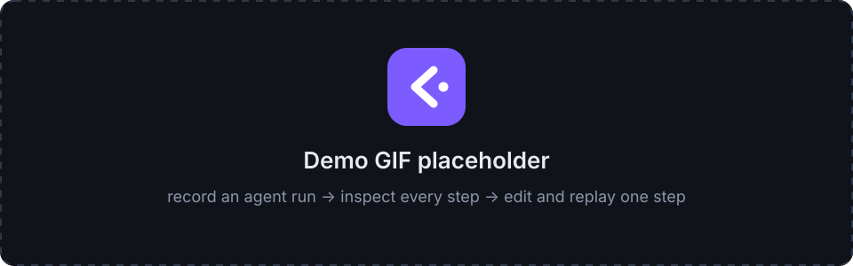
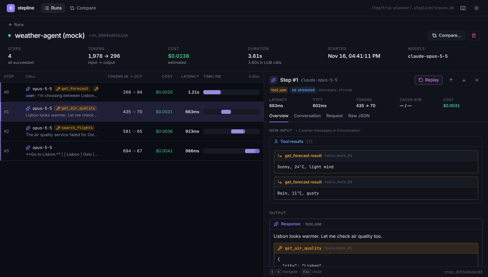
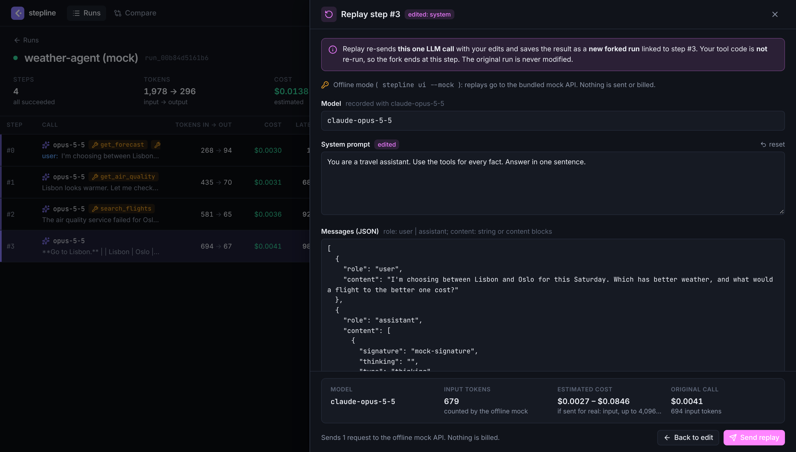
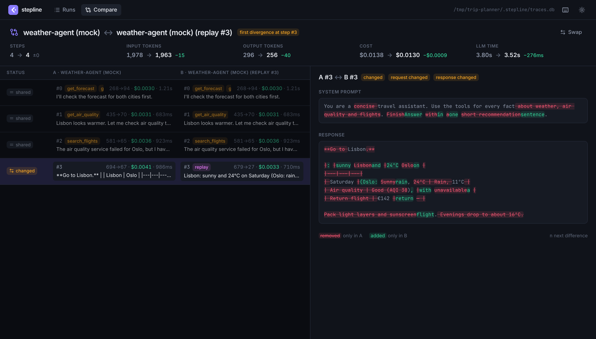
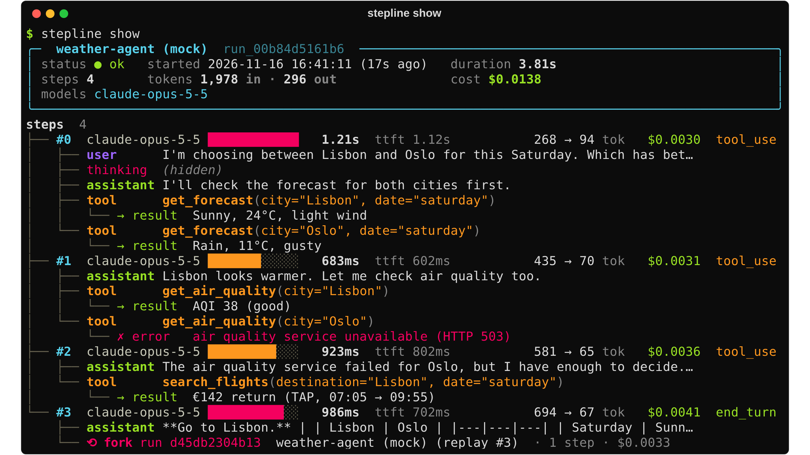
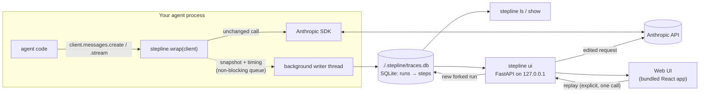

# Stepline

**A time-travel debugger for AI agents: record every LLM call, inspect each step in a local web UI, then edit any step and replay it as a new branch.**

[](https://github.com/dapdap777/stepline/actions/workflows/ci.yml)
[](LICENSE)



## Quickstart (30 seconds, no API key)

```bash
pip install "stepline[anthropic]"
stepline demo        # runs an example agent against an offline mock API and records it
stepline ui          # opens http://127.0.0.1:7777
```

Then record your own agent. These are the only two lines you add:

```python
import stepline
client = stepline.wrap(Anthropic())   # use `client` exactly as before
```

Run your agent as usual, then `stepline ui` (or `stepline show` in the terminal).

> **Not on PyPI yet.** Stepline hasn't had its first release. Until then,
> [install from source](#install-from-source).

---

## What you get

**A timeline of every call:** tokens, cost and latency per step, plus a waterfall showing when
each call ran. The gaps between bars are time spent in your own code, such as running tools.
Tool calls appear next to the results your code returned, and errors stand out.



**Replay any step with edits.** Change the system prompt, messages, tools, parameters or the
model, check the estimated cost, and send. The result is saved as a fork of the original run.



**Diff a fork against its parent:** step-by-step alignment plus word-level diffs of prompts,
parameters and responses.



**Or stay in the terminal:**



<sub>Screenshots come from `stepline demo` (the example agent below), viewed with
`stepline ui --mock` so the replay also ran offline.</sub>

## Features

Everything listed here exists and is covered by the test suite.

- **Two-line recording** for the Anthropic Python SDK, sync (`Anthropic`) and async
  (`AsyncAnthropic`). It records `messages.create` (including `stream=True`),
  `messages.stream` and `messages.parse`, on both `client.messages` and
  `client.beta.messages`. `wrap()` returns the same client object.
- **What's captured per call:** the exact request (messages, system prompt, tools, parameters),
  the response, tool calls linked to the tool results your code sent back, token usage
  (including prompt-cache reads and writes), estimated cost, latency, time to first token for
  streams, and errors.
- **Never breaks your app.** Recording happens on a background thread and adds well under a
  millisecond per call. Errors in the recorder are logged and swallowed, and API exceptions
  reach your code unchanged. Pending writes are flushed when the process exits.
- **Local storage:** SQLite at `./.stepline/traces.db` (WAL mode), plus a `.gitignore` written
  into `.stepline/` so traces aren't committed by accident.
- **Web UI:** run list with search and filters; a virtualized timeline, tested with 3,000 steps;
  a step panel showing full messages and tool calls; run-to-run diffs; dark (default) and light
  themes; keyboard navigation (`j`/`k`, `g`/`G`, `r`, `?`).
- **Replay:** edit a step and re-send that one call, after a cost estimate and an explicit
  confirmation. The result is saved as a new forked run, and the original run is never
  modified. API errors are kept as failed steps. `stepline ui --mock` lets you try replay
  offline.
- **CLI:** `stepline ls`, `show [RUN] [--step N]`, `rm`, `prices`, `demo`, `ui`, `openapi`.
  Runs can be referred to by id, unique id prefix, or name.
- **Cost estimates** from a built-in price table for Claude models. You can override or extend
  it in `.stepline/prices.toml`.

## Limits

- **Anthropic Python SDK only, for now** (`anthropic>=0.40,<3`; CI tests both ends of that
  range). OpenAI is next on the roadmap. Other SDKs, frameworks and languages aren't recorded.
  Bedrock, Vertex and Foundry clients from the `anthropic` package use the same interface, but
  they aren't tested yet.
- **Replay re-sends one LLM call. It does not re-run your tools or your agent.** A fork
  therefore ends at the replayed step, even if the new response asks for a tool.
- **Costs are estimates** based on first-party list prices. They don't account for batch
  discounts, partner-platform pricing or negotiated rates.
- **Single machine, single user.** It's a local development tool, not production monitoring,
  and there's no sharing or team view.
- **Traces contain your prompts and model outputs.** Strings that look like API keys are
  redacted, and request headers are never stored, but redaction is best-effort. Treat
  `.stepline/` as sensitive. See [SECURITY.md](SECURITY.md).

## Why Stepline

Hosted LLM tracing and observability platforms are the right tool for production. They offer
team dashboards, monitoring, evaluations and SDKs for many languages, and several are open
source and can be self-hosted. Stepline is deliberately narrower: a debugger for the edit-run-
inspect loop on your own machine.

|  | Stepline | Hosted tracing platforms (typical) |
|---|---|---|
| Setup | `pip install`, two lines of code | Account, project and API key, then an SDK or proxy |
| Where traces live | A SQLite file in your project | The vendor's cloud, or your own deployment |
| Telemetry | None. The UI makes no requests outside localhost | Varies by vendor |
| Re-running a step | Edit any recorded call and replay it as a forked branch, then diff against the original | Many offer a playground to re-run a prompt |
| Scope | One developer, one machine, Anthropic Python SDK | Teams, production traffic, many SDKs and frameworks |

### Similar tools for recording and replaying agent runs

Several open-source projects and one hosted service also record agent runs and let you replay
or fork them. The table summarizes what each project's own README (for Retrace, its
documentation) says it does. It isn't an independent evaluation, and it may be out of date.

| Project | How it records | What replay means there | Main focus |
|---|---|---|---|
| [Rewind](https://github.com/llm-rewind/rewind) (`llm-rewind`) | Local HTTPS proxy (mitmproxy, needs a local CA certificate) for OpenAI, Anthropic and Gemini, in any language | Deterministic cassette replay of a whole run, at zero LLM cost | Finding *why* two runs diverged (`rewind bisect`) and mutation-testing agents (`rewind mutate`), plus pytest |
| [AgentTape](https://github.com/MITHRAN-BALACHANDER/AgentTape) | LLM calls (automatic OpenAI interception) and tools wrapped with `@agenttape.tool`, saved as YAML cassettes | Deterministic offline replay; tools never re-execute. Partial replay can run the LLM live against a new prompt with tools frozen | Fast, safe agent tests in CI, plus a CLI with an ASCII waterfall, diff and an HTML viewer |
| [Stepfork](https://github.com/utsab345/stepfork) | Instrumented tool calls (`@trace_tool`) and LLM requests; adapters for OpenAI chat completions (non-streaming) and LangGraph | Frozen replay of your entrypoint; hybrid replay re-runs selected LLM calls; fork-at-step with output overrides | Turning a failed run into a pytest regression test, with behavioral diffs and failure minimization |
| AgentRewind ([JWang-Langer](https://github.com/JWang-Langer/agentrewind)) | Request fingerprints for OpenAI-compatible upstreams; side effects go through an idempotent channel | Deterministic replay; `arw rewind` re-runs live from step N with changed settings | A CLI that pinpoints the first diverging step and explains the request-level differences; no visual dashboard |
| AgentRewind ([Akshatkasera](https://github.com/Akshatkasera/codex-community-hackathon-del-AgentRewind), a hackathon project) | Imports runs from common agent frameworks | Patch a broken step and replay the downstream branch | A FastAPI + React app that diagnoses failed multi-agent runs and turns fixes into regression tests |
| [Retrace](https://retraceai.tech) (hosted) | Python and TypeScript SDKs capture LLM calls, tool calls and errors | Replay and fork recorded runs | A hosted service with a web dashboard, REST API, CLI and MCP server |

What Stepline does differently, and what it doesn't do:

- **Recording is an in-process wrapper:** `stepline.wrap(client)` around the Anthropic Python
  SDK. There's no proxy or certificate to install and no decorators on your tools. Streaming,
  async and tool-result linking work automatically. The flip side is that only that SDK is
  supported. Rewind's proxy covers more providers and any language, and Retrace offers Python
  and TypeScript SDKs.
- **Replay is a live, edited re-send of one call,** not a deterministic re-execution of your
  program. You change the prompt, messages, tools, parameters or model, see the estimated cost,
  and get a new branch you can diff against the original. Stepline doesn't capture or re-run
  your tools, so a fork ends at that step. AgentTape, Stepfork and AgentRewind (JWang-Langer)
  record tool calls or side effects and serve them back on replay. Both AgentRewind projects
  can continue a run past the point you changed.
- **It's an interactive debugger, not a test harness.** The main interface is a local web UI
  with a timeline of every step (tokens, cost, latency) and a step-by-step diff view. There's
  no pytest export, cassette replay in CI, divergence-cause inference or mutation testing. If you
  need those, the tools above are built for them.
- **It's local and needs no account,** like most of the open-source tools above. Retrace is a
  hosted service.

## How it works



- **Recorder.** `wrap()` patches the SDK's `messages` resources in place. A call snapshots its
  request on your thread and passes straight through to the SDK. Streams are observed chunk by
  chunk without being buffered. Normalization, redaction and SQL writes happen on a daemon
  thread. SDK support sits behind a small adapter interface, so other SDKs can be added.
- **Storage.** A run has many steps. Each step points at the step before it
  (`parent_step_id`), and a replay creates a new run whose step branches off the original's
  parent. Together the runs form a tree.
- **Server and UI.** A FastAPI app that binds to loopback, checks Host and Origin on every
  request, and serves a strict Content-Security-Policy. The UI is built into the Python
  package, so nothing is fetched from a CDN.

## The example agent

[`examples/weather_agent.py`](examples/weather_agent.py) is a ~150-line tool-using agent with
three toy tools that return canned data. It runs streamed turns, makes parallel tool calls,
and handles a tool failure.

```bash
python examples/weather_agent.py --mock   # offline mock API, no key needed
python examples/weather_agent.py          # real API, needs ANTHROPIC_API_KEY (costs a few cents)
stepline ui
```

`stepline demo` runs the same file in mock mode.

## Configuration

Zero configuration is required. The options are in [docs/configuration.md](docs/configuration.md):

- where traces are stored (`STEPLINE_DB`, `STEPLINE_DIR`), and how to turn recording off
  (`STEPLINE_DISABLED=1`);
- named runs: `with stepline.run("triage"): ...`;
- custom prices in `.stepline/prices.toml`;
- replay and API keys: the key is read from the environment when you replay and is never stored;
- the UI server's security model.

## Install from source

```bash
git clone https://github.com/dapdap777/stepline && cd stepline
uv sync                                        # Python deps (Python 3.10+)
(cd frontend && npm ci && npm run build)       # builds the UI into the package (Node 20+)
uv run stepline demo && uv run stepline ui
```

Without the frontend build, `stepline ui` serves a page explaining how to build it. The CLI
works either way.

## Roadmap

1. **OpenAI Python SDK adapter.** The recorder already goes through a `ProviderAdapter`
   interface; Chat Completions and Responses come next.
2. **Replay that continues:** opt-in registration of your tool functions, so a fork can keep
   running past the replayed step.
3. **Export and import a run** as a JSON file, to share a trace in a bug report.
4. **Search inside step content** (messages, tool inputs and results).
5. **Prompt-cache view:** cache hit rate per step and per run.
6. **Retention:** `stepline gc --older-than 30d`.

Smaller, self-contained items are listed as good first issues in [CONTRIBUTING.md](CONTRIBUTING.md).

## Contributing

Contributions are welcome: bug reports, adapters for other SDKs, UI improvements. Start with
[CONTRIBUTING.md](CONTRIBUTING.md), which covers development setup, the test commands
(`make check`, `npm run e2e`) and good first issues. Please report security issues privately,
as described in [SECURITY.md](SECURITY.md).

## License

[MIT](LICENSE)
